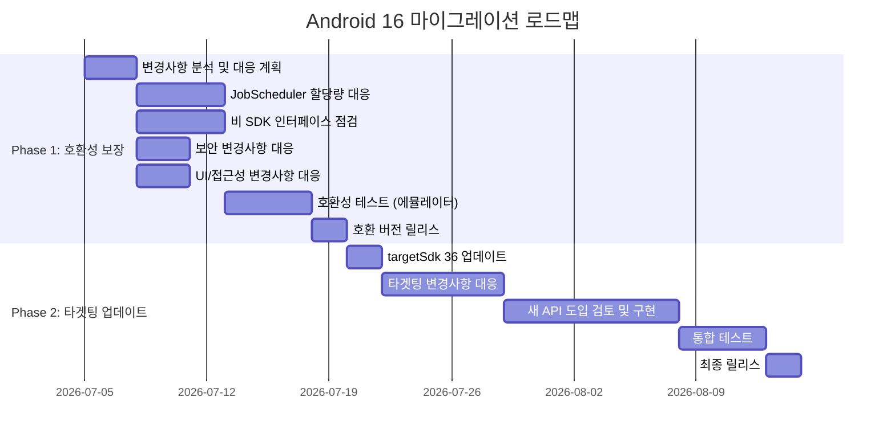

# Android 16 (API 36) OS Target 대응 조사 보고서

> **작성일**: 2026-07-05
> **작성자**: Hermes Agent
> **대상**: Android OS Target 16 대응 마이그레이션

---

## 1. 개요

Android 16 (API Level 36)은 AOSP에 출시되어 사용자에게 제공되고 있습니다. 기존 앱이 Android 16에서 안정적으로 동작하고 새로운 플랫폼 기능을 최대한 활용하기 위해서는 체계적인 마이그레이션 계획이 필요합니다.

### 1.1 핵심 원칙

| 구분 | 내용 |
|------|------|
| **Phase 1: 호환성 보장** | targetSdkVersion 변경 없이 Android 16에서 앱이 정상 동작하도록 보장 (최종 출시 전까지 완료) |
| **Phase 2: 타겟팅 업데이트** | targetSdkVersion 36으로 업데이트하고 새 API/기능 활용 (최종 출시 후) |

---

## 2. Phase 1: 모든 앱에 적용되는 동작 변경사항

> `targetSdkVersion`과 관계없이 Android 16에서 실행되는 모든 앱에 적용됩니다.

### 2.1 핵심 기능 변경사항

#### 2.1.1 JobScheduler 할당량 최적화
- **영향**: WorkManager, JobScheduler, DownloadManager 사용 모든 앱
- **변경 내용**:
  - 앱 대기 버킷(Standby Bucket) 기반 런타임 할당량 조정
  - 활성(Active) 대기 버킷 → 넉넉한 할당량 적용
  - 앱이 포그라운드(FGS) 상태에서 시작된 작업도 작업 런타임 할당량 준수
  - 사용자에게 표시되는 동안 시작된 작업, 표시되지 않게 된 후에도 할당량 적용
- **대응**: `WorkInfo.getStopReason()` / `JobParameters.getStopReason()` 로깅 추가
- **테스트 ADB 명령어**:
  ```
  # 할당량 최적화 비활성화
  adb shell am compat enable OVERRIDE_QUOTA_ENFORCEMENT_TO_TOP_STARTED_JOBS <package>
  adb shell am compat enable OVERRIDE_QUOTA_ENFORCEMENT_TO_FGS_JOBS <package>
  
  # 앱 대기 버킷 설정
  adb shell am set-standby-bucket <package> active|working_set|frequent|rare|restricted
  ```
- **권장사항**: `getPendingJobReasonsHistory()` API 활용하여 작업 미실행 원인 파악

#### 2.1.2 비어 있는 작업 중지 이유 (STOP_REASON_TIMEOUT_ABANDONED)
- **영향**: JobScheduler 직접 사용 앱 (WorkManager/AsyncTask/DownloadManager는 영향 없음)
- **변경 내용**: GC된 JobParameters 객체는 `STOP_REASON_TIMEOUT` 대신 `STOP_REASON_TIMEOUT_ABANDONED` 수신
- **대응**: 새 중지 이유 코드 처리 로직 추가

#### 2.1.3 JobInfo#setImportantWhileForeground 지원 중단 완료
- **변경 내용**: Android 12부터 지원 중단되었으나, Android 16에서는 완전히 무시됨
- **대응**: `setImportantWhileForeground(true)` 호출 제거 또는 조건부 처리

#### 2.1.4 주문된 브로드캐스트 우선순위 범위 제한
- **영향**: 여러 프로세스 간 ordered broadcast 의존하는 앱
- **변경 내용**:
  - 브로드캐스트 우선순위는 **동일 프로세스 내에서만** 적용
  - 우선순위 범위는 `(SYSTEM_LOW_PRIORITY + 1, SYSTEM_HIGH_PRIORITY - 1)`로 자동 제한
- **대응**: 프로세스 간 조정이 필요한 경우 별도 통신 채널 구현

#### 2.1.5 ART 내부 변경사항
- **영향**: 비 SDK 인터페이스(내부 ART 구조) 사용 라이브러리/코드
- **변경 내용**: ART 성능 개선 및 새 Java 기능 지원 → 내부 구조 변경 가능성 높음
- **대응**:
  - 비 SDK 인터페이스 사용 여부 점검
  - 공개 API 대안 탐색
  - Issue Tracker에 기능 요청 제출

#### 2.1.6 16KB 페이지 크기 호환성 모드
- **영향**: 4KB 정렬 메모리 페이지로 빌드된 앱
- **변경 내용**:
  - Android 16에서 4KB 정렬 앱 감지 시 **자동 호환성 모드** 활성화
  - 사용자에게 알림 대화상자 표시됨
- **대응**:
  - `AndroidManifest.xml`에 `android:pageSizeCompat` 속성 설정 (Android 16 SDK로 컴파일 필요)
  - 장기적으로 16KB 정렬로 앱 업데이트 (성능/안정성 최적)

### 2.2 사용자 환경 및 시스템 UI

#### 2.2.1 접근성 announceForAccessibility 지원 중단
- **영향**: `announceForAccessibility()` 또는 `TYPE_ANNOUNCEMENT` 사용 앱
- **대안**:
  - UI 창 변경: `Activity.setTitle()` / `setAccessibilityPaneTitle()` / Compose `paneTitle`
  - 중요 변경 알림: `setAccessibilityLiveRegion()` / Compose `liveRegion`
  - 오류 알림: `AccessibilityEvent.CONTENT_CHANGE_TYPE_ERROR` / `setError()`

#### 2.2.2 3버튼 탐색 뒤로 예측 지원
- **영향**: 뒤로 탐색 예측을 구현한 앱
- **변경 내용**: 3버튼 탐색 모드에서도 뒤로 버튼 길게 누르면 예측 애니메이션 지원

#### 2.2.3 자동 테마 앱 아이콘
- **변경 내용**: Android 16 QPR2부터 자체 테마 아이콘이 없는 앱에 시스템이 자동 테마 적용
- **대응**: 적응형 아이콘 내 단색 레이어 포함하여 디자인 제어

### 2.3 기기 폼 팩터

#### 2.3.1 가상 기기 소유자 재정의
- **영향**: 가상 기기(Virtual Device)에서 실행되는 앱
- **변경 내용**: 가상 기기 소유자가 앱 설정(방향, 가로세로 비율, 크기 조정) 재정의 가능

### 2.4 보안 변경사항

#### 2.4.1 인텐트 리디렉션 공격 기본 보안 강화
- **영향**: Intent 객체를 extra로 전달/실행하는 모든 앱
- **변경 내용**:
  - Intent 리디렉션 공격에 대한 기본 보안 제공
  - 불필요한 `removeLaunchSecurityProtection()` 호출은 취약점 유발
- **선택 해제 방법** (꼭 필요한 경우만):
  ```kotlin
  // Android 16 SDK 컴파일
  intent.getParcelableExtra<Intent>("sub_intent")?.removeLaunchSecurityProtection()
  
  // Android 15 이하 SDK 컴파일 (리플렉션, 비권장)
  val method = Intent::class.java.getDeclaredMethod("removeLaunchSecurityProtection")
  method.invoke(subIntent)
  ```

#### 2.4.2 컴패니언 기기 검색 타임아웃 알림 변경
- **영향**: Companion Device Manager(CDM) 사용 앱
- **변경 내용**:
  - `RESULT_DISCOVERY_TIMEOUT` 대신 사용자 대화상자 → `RESULT_USER_REJECTED`
  - 검색 시간 20초로 연장
  - 첫 20초 내 기기 발견 시 검색 중지

### 2.5 연결 변경사항

#### 2.5.1 블루투스 결합 손실 처리 개선
- **영향**: 블루투스 사용 앱
- **변경 내용**:
  - 자동 결합 삭제 → 로컬 페어링 정보 유지 + 사용자 대화상자 표시
  - 재페어링 로직 변경 필요성 검토

---

## 3. Phase 2: Android 16 타겟팅 시 추가 변경사항

> `targetSdkVersion`을 36으로 업데이트하는 앱에만 추가로 적용됩니다.

### 3.1 필요 작업

1. **SDK 설정**
   - Android Studio 최신 버전 설치
   - `compileSdkVersion` → 36
   - `targetSdkVersion` → 36

2. **Android 16 타겟팅 동작 변경사항 검토**
   - [behavior-changes-16](https://developer.android.com/about/versions/16/behavior-changes-16?hl=ko) 전체 검토
   - 개인정보 보호 변경사항 대응 (코드/아키텍처 수정)
   - 호환성 전환(Compat Toggles) 활용하여 변경사항별 테스트

3. **새 API 도입**
   - Android 16 API 활용 가능 영역 분석
   - 새 기능 도입 계획 수립

### 3.2 호환성 전환 (Compat Toggles)

Android 16에서 타겟팅된 각 동작 변경사항별로 고유 ID가 제공됩니다.
- `adb` 명령어로 개별 변경사항 on/off 테스트 가능
- `targetSdkVersion` 변경 없이 영향 평가 가능

```
# 특정 변경사항 활성화 (targetSdk 변경 없이)
adb shell am compat enable CHANGE_ID <package>

# 특정 변경사항 비활성화
adb shell am compat disable CHANGE_ID <package>
```

---

## 4. 라이브러리/SDK 호환성

### 4.1 확인 사항
- 서드파티 SDK의 Android 16 호환성 확인
- 비 SDK 인터페이스 사용 여부 검증 (logcat 경고, StrictMode)
- 필요시 SDK 최신 버전으로 업데이트 또는 개발자 연락

### 4.2 주요 점검 라이브러리 (예시)
- Firebase SDK
- Crash reporting SDK (Firebase Crashlytics 등)
- 광고 SDK
- 결제 SDK
- 분석/로그 SDK

---

## 5. 전체 마이그레이션 로드맵



---

## 6. 참고 링크

| 자료명 | URL |
|-------|-----|
| Android 16 Migration Guide (한국어) | https://developer.android.com/about/versions/16/migration?hl=ko |
| 모든 앱 동작 변경사항 (한국어) | https://developer.android.com/about/versions/16/behavior-changes-all?hl=ko |
| Android 16 타겟팅 앱 동작 변경사항 (한국어) | https://developer.android.com/about/versions/16/behavior-changes-16?hl=ko |
| 비 SDK 인터페이스 제한 (한국어) | https://developer.android.com/about/versions/16/changes/non-sdk-16?hl=ko |
| SDK 설정 가이드 (한국어) | https://developer.android.com/about/versions/16/setup-sdk?hl=ko |
| 호환성 프레임워크 (한국어) | https://developer.android.com/about/versions/16/reference/compat-framework-changes?hl=ko |

---

*본 보고서는 Android Developers 공식 문서와 Hermes Agent의 자동 분석을 기반으로 작성되었습니다.*

---

## 7. Orchestrator 작업 내역

| 항목 | 내용 |
|------|------|
| **Orchestrator 태스크** | t_9b3cf067 |
| **Orchestrator 프로필** | orchestrator |
| **작업 시작** | 2026-07-05 17:27 |
| **상태** | 하위 태스크 디스패치 완료 |

### 7.1 수행 작업
1. `req.md` 분석 — Android 16 OS Target 대응 조사 요구사항 파악
2. 기존 파일(task.md, result.md, report.md, raws.md) 상태 확인
3. Obsidian Clipping 문서(`Android 16으로 앱 이전`) 참조 자료 확인
4. `task.md` 업데이트 — 모든 작업 항목에 Agent Profile 컬럼 추가
5. Kanban 하위 태스크 4개 생성 및 디스패치

### 7.2 하위 태스크 현황

| Kanban ID | 작업명 | 담당 Agent | 상태 |
|-----------|-------|-----------|------|
| t_a365b140 | Phase 1: Android 16 호환성 보장 (Tasks 1-8) | coding-agent | todo |
| t_63e41af0 | Phase 2: Android 16 타겟팅 업데이트 (Tasks 9, 10, 12, 13) | coding-agent | todo |
| t_929b2e8e | Phase 2: Android 16 새 API 기능 도입 검토 (Task 11) | research-worker | todo |
| t_bc9c0436 | Android 16 테스트 계획 실행 (T1-T5) | coding-agent | todo |

### 7.3 다음 단계
- 각 하위 태스크가 dispatcher에 의해 자동으로 실행됨
- 각 agent 완료 후 result.md 업데이트 예정
- 모든 Phase 완료 후 GitHub 푸시 및 report.md 최종 업데이트 예정
